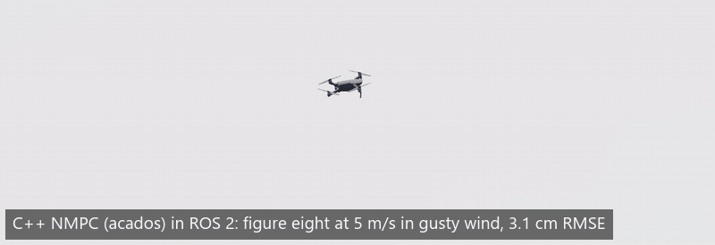
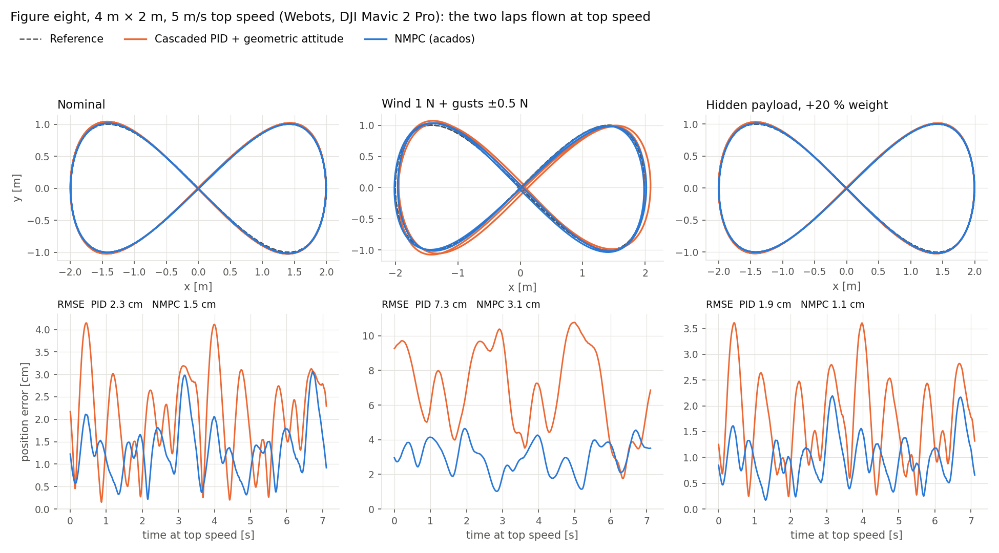
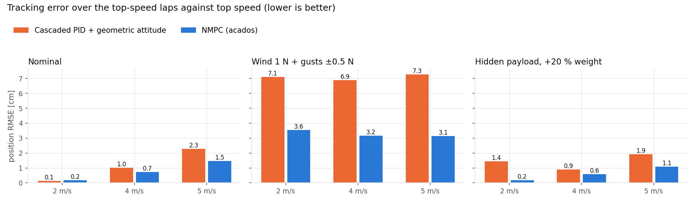
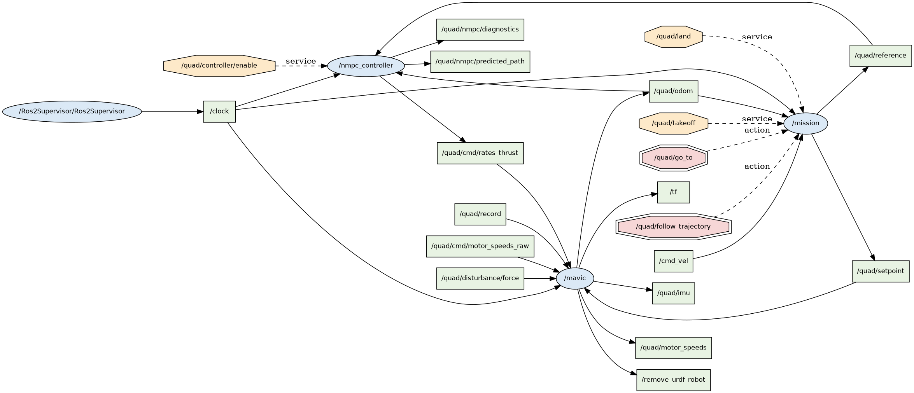

# Quadrotor control in ROS 2 and Webots: nonlinear MPC vs. cascaded control



I fly a DJI Mavic 2 Pro in Webots through ROS 2 Jazzy with my own C++ stack and compare two controllers that both output collective thrust and body rates:

- `nmpc_controller`: nonlinear MPC, 20 steps over 1 s, solved at 100 Hz by acados, with a disturbance observer.
- `position_controller`: cascaded PID with geometric attitude control (Lee, Leok & McClamroch 2010) and body-rate feedforward from the reference jerk (Mellinger & Kumar 2011).

## Results

Figure eight, 4 m × 2 m, top speed 2 to 5 m/s, error against the exact path. Neither controller knows about the wind or payload.

| Scenario | Top speed | Cascaded PID: RMSE / max error | NMPC: RMSE / max error | NMPC solve time: median / p99 / max |
|---|---|---|---|---|
| Nominal | 2 m/s | 0.1 / 0.4 cm | 0.2 / 0.3 cm | 0.49 / 1.00 / 2.43 ms |
| Nominal | 4 m/s | 1.0 / 1.9 cm | 0.7 / 1.6 cm | 0.48 / 0.78 / 2.20 ms |
| Nominal | 5 m/s | 2.3 / 4.1 cm | 1.5 / 3.1 cm | 0.49 / 1.16 / 1.43 ms |
| Wind 1 N + gusts ±0.5 N | 2 m/s | 7.1 / 10.8 cm | 3.6 / 5.1 cm | 0.46 / 0.79 / 1.62 ms |
| Wind 1 N + gusts ±0.5 N | 4 m/s | 6.9 / 10.5 cm | 3.2 / 4.9 cm | 0.48 / 0.89 / 5.99 ms |
| Wind 1 N + gusts ±0.5 N | 5 m/s | 7.3 / 10.8 cm | 3.1 / 4.6 cm | 0.50 / 0.86 / 1.46 ms |
| Hidden payload, +20 % weight | 2 m/s | 1.4 / 2.4 cm | 0.2 / 0.3 cm | 0.49 / 0.81 / 2.12 ms |
| Hidden payload, +20 % weight | 4 m/s | 0.9 / 1.6 cm | 0.6 / 1.0 cm | 0.49 / 0.90 / 1.68 ms |
| Hidden payload, +20 % weight | 5 m/s | 1.9 / 3.6 cm | 1.1 / 2.2 cm | 0.53 / 1.02 / 2.82 ms |





In gusty wind the NMPC halves the error at every speed: its observer feeds the wind estimate into the model, while the integrator waits for an error. Otherwise both stay within about 2 cm up to 4 m/s, and the NMPC only pulls ahead near the thrust and tilt limits, as Sun et al. (T-RO 2022) found. It runs in 0.46 to 0.53 ms median on a 2016 laptop CPU, against a 10 ms period.

Both controllers get the same limits, mass and reference. Without the body-rate feedforward the cascaded controller was 49 cm off at 4 m/s instead of 1 cm, which would have made the NMPC look far better than it is.

Limits: one simulator, one drone, no sensor noise, a close model. Real flight will be worse for both.

### Three bugs that changed the numbers

- Odometry was stamped one simulation step late (4 ms is 2 cm at 5 m/s). It now uses Webots time.
- rclpy accepted `laps=2` (an int) for a `float64` field and the server received about 0, so the first runs flew no lap at top speed. The benchmark now parses it as a float.
- SIGINT doesn't stop a background `ros2 launch`, so one run had both controllers driving the drone. `run_benchmark.sh` now stops each stack with SIGTERM.

## Notes



Webots' propeller model lagged motor commands by 1 to 3 s in my tests (`scripts/motor_ident.py`), so the driver models the rotors itself: first-order motor speed (30 ms), thrust and torque applied through the supervisor API.

## Build and run

You need ROS 2 Jazzy in WSL2 (Ubuntu 24.04), `ros-jazzy-webots-ros2`, Webots R2025a on Windows, and for the NMPC the acados libraries:

```bash
git clone --branch v0.5.5 --depth 1 --recurse-submodules --shallow-submodules https://github.com/acados/acados.git ~/acados
cd ~/acados && mkdir build && cd build
cmake -DACADOS_WITH_QPOASES=OFF -DACADOS_INSTALL_DIR=$HOME/acados .. && make install -j4
```

Without acados, only the NMPC is skipped.

```bash
mkdir -p ~/quad_ws && cd ~/quad_ws
ln -s /mnt/d/Work/quadrotor-ros2/src src     # or clone the repo into src/
source /opt/ros/jazzy/setup.bash
colcon build --symlink-install
colcon test && colcon test-result --verbose
source install/setup.bash
ros2 launch quad_webots sim.launch.py controller:=nmpc    # or controller:=pid; add rviz:=true for RViz
```

Then, in another terminal:

```bash
ros2 service call /quad/takeoff std_srvs/srv/Trigger
ros2 action send_goal --feedback /quad/follow_trajectory quad_interfaces/action/FollowTrajectory "{shape: lemniscate, size: 2.0, max_speed: 4.0, laps: 2.0, start: {x: 0.0, y: 0.0, z: 1.5}}"
ros2 topic pub -r 20 /quad/disturbance/force geometry_msgs/msg/Vector3 "{x: 1.0}"    # 1 N of wind
ros2 service call /quad/land std_srvs/srv/Trigger
```

Benchmark (about 35 minutes per controller):

```bash
bash scripts/run_benchmark.sh C:/Users/me/flight.mp4
python3 scripts/plot_benchmark.py
```

The Windows firewall must let WSL reach Webots on TCP 1234.

## License

MIT
