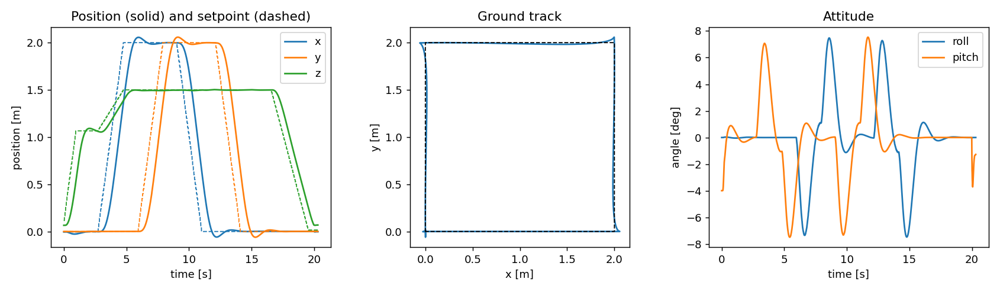

# Quadrotor control stack in ROS 2 and Webots

A DJI Mavic 2 Pro in Webots, flown through ROS 2 Jazzy by my own stack:
- a C++ driver plugin that publishes the state and runs the inner loops;
- a C++ position controller;
- a mission layer with services and an action.

The low-level interface (collective thrust + body rates) is the one PX4 exposes, so the position controller can later be swapped for a nonlinear MPC without touching the simulator side.

> Status: the stack flies. It takes off, holds a hover, follows `go_to` goals and lands. A 2 m square at 1.5 m reaches each corner within 6 cm (figure below). The nonlinear MPC comes next.



*A 2 m square at 1.5 m height, flown with `/quad/go_to` goals. Solid lines are the measured position, dashed lines the setpoint; the setpoint moves at 1 m/s. Attitude stays within ±8°.*

## Architecture

```
 Webots (Windows)                         ROS 2 Jazzy (WSL2, Ubuntu 24.04)
┌────────────────────────────┐  /quad/odom, /quad/imu, TF  ┌─────────────────────────────┐
│ MavicDriver (C++ plugin)   │ ──────────────────────────► │ position_controller (C++)   │
│  GPS, inertial unit, gyro  │                             │  pos → vel → acc → attitude │
│  body-rate PI loop         │ ◄────────────────────────── │  (geometric attitude error) │
│  mixer → 4 propeller speeds│  /quad/cmd/rates_thrust     └──────────────▲──────────────┘
└────────────────────────────┘                                            │ /quad/setpoint
                                                           ┌──────────────┴──────────────┐
           ros2 service call /quad/takeoff, /quad/land ───►│ mission (Python)            │
           ros2 action send_goal /quad/go_to ─────────────►│  setpoint at bounded speed  │
           teleop_twist_keyboard  (/cmd_vel) ─────────────►│  teleop in the yaw frame    │
                                                           └─────────────────────────────┘
```

| Package | Language | Content |
|---|---|---|
| `quad_interfaces` | IDL | `RatesThrust.msg` (thrust [N] + body rates [rad/s]), `GoTo.action` |
| `quad_webots` | C++ | world, driver plugin, mixer (+ gtest), parameters, launch |
| `quad_control` | C++ | position controller, enable/disable service |
| `quad_mission` | Python | takeoff/land services, `go_to` action server, teleop, square demo (action client) |

## Rotor model and identification

**Webots' own propeller model is not used.** In open-loop tests (`scripts/motor_ident.py`), its thrust followed motor speed commands with a lag of 1 to 3 s: after a step to well above hover speed, the drone stayed on the ground for over 2 s before lifting off. No controller can stabilise an actuator like that, and Webots does not document the behaviour. So the driver models the rotors itself, as RotorS and RotorPy do:
- **Motor:** first-order speed response, time constant 30 ms.
- **Forces:** thrust f = k_t ω² at each `Propeller.centerOfThrust`, and a reaction torque k_q ω², applied through the supervisor API. The constants are the PROTO's: k_t = 2.6·10⁻⁴ and k_q = 5.2·10⁻⁶.
- **Webots propellers:** their motors stay at zero speed, so Webots adds no thrust of its own.

What was measured rather than assumed:

| Quantity | Value | How |
|---|---|---|
| Centre of mass (body frame) | (−6.1, 0.0, −3.6) cm | supervisor API at start-up (the bare body is at −8.8 cm; propellers and gimbal move it forward) |
| Mass | 0.50 kg | steady hover thrust of the position controller (4.80–4.97 N over three flights) |

With the measured centre of mass, the front and rear arms are almost equal (11.6 cm). The mixer inverts the 4×4 map from rotor thrusts to (thrust, torque) and clips each rotor to its speed limit.

Two more simulator details had to be handled:
- **Body sleep:** Webots puts resting bodies to sleep after 1 s, so the world sets `physicsDisableTime` high.
- **Clock:** `/clock` comes from the `Ros2Supervisor` node, so every node runs on simulation time.

## Build and run

Requires ROS 2 Jazzy in WSL2 (Ubuntu 24.04), `ros-jazzy-webots-ros2`, and Webots R2025a installed on Windows.

```bash
mkdir -p ~/quad_ws && cd ~/quad_ws
ln -s /mnt/d/Work/quadrotor-ros2/src src     # or clone the repo into src/
source /opt/ros/jazzy/setup.bash
colcon build --symlink-install
colcon test --packages-select quad_webots && colcon test-result --verbose
source install/setup.bash
ros2 launch quad_webots sim.launch.py        # add rviz:=true for RViz
```

Run each of these in another terminal:

```bash
ros2 service call /quad/takeoff std_srvs/srv/Trigger
ros2 action send_goal --feedback /quad/go_to quad_interfaces/action/GoTo "{target: {x: 2.0, y: 1.0, z: 1.5}, yaw: 0.0, tolerance: 0.1}"
ros2 run teleop_twist_keyboard teleop_twist_keyboard
ros2 run quad_mission square_demo
ros2 service call /quad/land std_srvs/srv/Trigger
```

**Safety behaviour:**
- The motors stay off until the first command arrives.
- If commands stop for 0.3 s, the driver levels the drone and descends at 0.4 m/s. It uses a hover thrust learned in flight, so a wrong mass parameter cannot make the drone climb (an early version did exactly that).
- Once the drone is on the ground, the motors stop.
- Landing ends only when the drone is at its takeoff height and has stayed still for 0.5 s.

**Windows + WSL2 notes:**
- Webots runs on Windows and the stack runs in WSL2.
- `scripts/sim.sh` sets `WEBOTS_HOME`. The launch file passes the Windows host IP (the WSL default gateway) to the controllers, because webots_ros2 reads it from `/etc/resolv.conf`, which is wrong under systemd-resolved.
- The Windows firewall must let WSL reach Webots on TCP 1234, for example with a rule limited to `172.16.0.0/12` and `webots-bin.exe`.

**Tools:**
- `scripts/flight_test.py` flies a scripted mission (`--square 2`) and logs it to CSV.
- `scripts/plot_flight.py` draws the figure above.
- `scripts/motor_ident.py` runs the open-loop rotor tests.

## Roadmap
1. Gain tuning (the 1 m/s ramps lag by about 1 s and overshoot by 6 cm), wind and payload disturbances.
2. Nonlinear MPC (acados, SQP-RTI, C++ node) behind the same `RatesThrust` interface.
3. Benchmark against this cascaded controller and a geometric SE(3) controller (trajectory speed, wind, model mismatch, solve times).

## License
MIT
