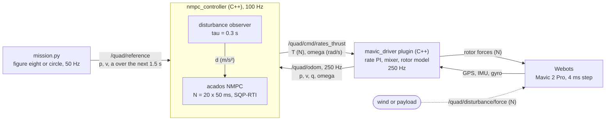

# quadrotor-ros2: nonlinear MPC vs. cascaded geometric control in ROS 2 and Webots

A C++ ROS 2 Jazzy stack that flies a simulated DJI Mavic 2 Pro in Webots with two interchangeable controllers, an acados NMPC solved in 0.5 ms and a cascaded geometric controller. On a 5 m/s figure eight in gusty wind the NMPC halves the tracking error (3.1 vs 7.3 cm RMSE, one run per case).

[Benchmark data](results/benchmark) · [Formulation and tuning](docs/FORMULATION.md) · [ROS graph](docs/ros_graph.png)


*Cascaded controller (top) and NMPC (bottom) on the same 5 m/s figure eight, same wind and camera, from the start of the fast lap. Reference in black, flown path in blue. A separate rerun recorded for the video: its log is not in `results/`, and the table below uses the benchmark run.*

A personal project from October 2026, in simulation only. The question: on the same thrust and body-rate interface, does an NMPC with a disturbance observer track better than a well-tuned cascaded controller with flatness feedforward, and where?

## Overview

Both controllers read `/quad/odom` and the reference and publish collective thrust and body rates on `/quad/cmd/rates_thrust`, the split PX4 uses, so they can be swapped without touching the simulator side. A Webots driver plugin closes the body-rate loop and models the rotors. All code in `src/` and `scripts/` is mine, except the acados C code in `src/quad_control/nmpc/c_generated_code/`, which [`generate_solver.py`](src/quad_control/nmpc/generate_solver.py) generates. Webots, its Mavic 2 Pro model, webots_ros2 and acados are upstream; the control laws follow the papers in References.



*The NMPC loop. The cascaded controller ([`position_controller.cpp`](src/quad_control/src/position_controller.cpp)) takes its place with the same inputs and output, without the observer.*

The NMPC model has 10 states (position, velocity, quaternion) and 4 inputs (thrust, body rates), with the estimated external acceleration $`d`$ as a parameter:

```math
\dot p = v, \qquad \dot v = \frac{T}{m} R(q)\, e_3 - g\, e_3 + d, \qquad \dot q = \tfrac12\, q \otimes (0, \omega),
\qquad T \in [0.5,\ 9.81]\ \mathrm{N}, \quad |\omega| \le (6, 6, 3)\ \mathrm{rad/s}
```

The cost is linear least squares on $`[x, u]`$ against the reference over 1 s, with one SQP-RTI iteration per step (HPIPM, partial condensing, RK4). The cascaded baseline is P on position, PI on velocity, geometric attitude control (Lee et al. 2010) with tilt capped at 60°, and body-rate feedforward from the reference jerk (Mellinger and Kumar 2011). Weights, gains and tuning: [docs/FORMULATION.md](docs/FORMULATION.md).

## Results

Figure eight, 4 m x 2 m, top speed 2 to 5 m/s, position error against the analytic reference over the laps at top speed, one run per cell. Neither controller knows about the wind or the payload; both get the same mass, reference, thrust limit and body-rate limits. Source: [`benchmark_pid.json`](results/benchmark/benchmark_pid.json), [`benchmark_nmpc.json`](results/benchmark/benchmark_nmpc.json).

| Scenario | Top speed | Cascaded: RMSE / max [cm] | NMPC: RMSE / max [cm] | NMPC solve: median / p99 / max [ms] |
|---|---|---|---|---|
| Nominal | 2 m/s | 0.1 / 0.4 | 0.2 / 0.3 | 0.49 / 1.00 / 2.43 |
| Nominal | 4 m/s | 1.0 / 1.9 | 0.7 / 1.6 | 0.48 / 0.78 / 2.20 |
| Nominal | 5 m/s | 2.3 / 4.1 | 1.5 / 3.1 | 0.49 / 1.16 / 1.43 |
| Wind 1 N + gusts ±0.5 N | 2 m/s | 7.1 / 10.8 | **3.6 / 5.1** | 0.46 / 0.79 / 1.62 |
| Wind 1 N + gusts ±0.5 N | 4 m/s | 6.9 / 10.5 | **3.2 / 4.9** | 0.48 / 0.89 / 5.99 |
| Wind 1 N + gusts ±0.5 N | 5 m/s | 7.3 / 10.8 | **3.1 / 4.6** | 0.50 / 0.86 / 1.46 |
| Hidden payload, +20 % weight | 2 m/s | 1.4 / 2.4 | 0.2 / 0.3 | 0.49 / 0.81 / 2.12 |
| Hidden payload, +20 % weight | 4 m/s | 0.9 / 1.6 | 0.6 / 1.0 | 0.49 / 0.90 / 1.68 |
| Hidden payload, +20 % weight | 5 m/s | 1.9 / 3.6 | 1.1 / 2.2 | 0.53 / 1.02 / 2.82 |


- In gusty wind the NMPC halves the error at every speed: the observer feeds the wind estimate into the model, while the PI integrator waits for an error to build up.
- Without disturbance both stay under 1.5 cm RMSE up to 4 m/s. The cascaded controller is slightly better at 2 m/s, the NMPC at 4 and 5 m/s, where tilt reaches 43 to 59°. Thrust never saturated in any run. This matches the nuanced conclusion of Sun et al. (T-RO 2022).
- With the hidden payload the observer removes the offset the cascaded controller shows at 2 m/s (0.2 vs 1.4 cm).
- Solve time 0.46 to 0.53 ms median on a 2016 laptop CPU (i7-6700HQ), against a 10 ms period.

### How I checked it

- The baseline is tuned, not a strawman: jerk feedforward, and gains from a sweep at 4 m/s, the stiffest stable setting ([`position_controller.yaml`](src/quad_control/config/position_controller.yaml)). Without the feedforward it was far worse at 4 m/s (an earlier run, not kept).
- The mass, 0.50 kg, comes from the hover thrust measured in two flights, 4.80 to 4.94 N ([`mavic.yaml`](src/quad_webots/config/mavic.yaml)).
- Errors are computed against the closed-form path, not the logged reference samples, of which about 0.1 % were off by up to 3 cm ([`bench_metrics.py`](scripts/bench_metrics.py)).
- Unit tests: gtest for the reference sampling and the mixer, pytest for the trajectories (`colcon test`).
- Three bugs changed the numbers. Odometry was stamped one simulation step late (4 ms is 2 cm at 5 m/s); it now uses Webots time. `laps=2`, sent as an int to a `float64` field, arrived as about 0, so the first runs flew no lap at top speed. SIGINT did not stop a background `ros2 launch`, so one run had both controllers driving the drone; `run_benchmark.sh` now uses SIGTERM.

## Installation

Tested on WSL2 Ubuntu 24.04 with ROS 2 Jazzy and `ros-jazzy-webots-ros2`, Webots R2025a on Windows, acados v0.5.5 and CasADi 3.7.2 (the version that generated the committed solver code), on an i7-6700HQ laptop. The acados libraries, for the NMPC:

```bash
git clone --branch v0.5.5 --depth 1 --recurse-submodules --shallow-submodules https://github.com/acados/acados.git ~/acados
cd ~/acados && mkdir build && cd build
cmake -DACADOS_WITH_QPOASES=OFF -DACADOS_INSTALL_DIR=$HOME/acados .. && make install -j4
```

Without acados, only the NMPC is skipped. The solver's C code is committed, so the build does not need Python.

```bash
mkdir -p ~/quad_ws && cd ~/quad_ws
ln -s /path/to/quadrotor-ros2/src src     # or clone the repo into src/
source /opt/ros/jazzy/setup.bash
colcon build --symlink-install
colcon test && colcon test-result --verbose
```

The Windows firewall must let WSL reach Webots on TCP 1234.

## Usage

```bash
source ~/quad_ws/install/setup.bash
ros2 launch quad_webots sim.launch.py controller:=nmpc    # or controller:=pid; add rviz:=true for RViz
```

The log shows "Mavic driver ready" and, for the NMPC, "NMPC ready: N = 20, dt = 50 ms". Then, in another terminal:

```bash
ros2 service call /quad/takeoff std_srvs/srv/Trigger
ros2 action send_goal --feedback /quad/follow_trajectory quad_interfaces/action/FollowTrajectory "{shape: lemniscate, size: 2.0, max_speed: 4.0, laps: 2.0, start: {x: 0.0, y: 0.0, z: 1.5}}"
ros2 topic pub -r 20 /quad/disturbance/force geometry_msgs/msg/Vector3 "{x: 1.0}"    # 1 N of wind
ros2 service call /quad/land std_srvs/srv/Trigger
```

## Reproducing the results and figures

| Output | Command |
|---|---|
| `results/benchmark/benchmark_{pid,nmpc}.json`, raw logs in `results/benchmark/runs/` | `bash scripts/run_benchmark.sh [video path on the Windows host]` (about 35 min per controller) |
| `docs/benchmark_paths.png`, `docs/benchmark_rmse.png`, the table | `python3 scripts/plot_benchmark.py` (needs the raw logs) |
| README GIFs | `python3 scripts/make_gif.py <recording.mp4> docs/<name>.gif` |
| `docs/ros_graph.png` | `bash scripts/ros.sh python3 scripts/graph_dot.py > docs/ros_graph.dot`, then `dot -Tpng` |
| solver C code | `python3 src/quad_control/nmpc/generate_solver.py` |

## Code structure

| Component | File | Role |
|---|---|---|
| NMPC | [`generate_solver.py`](src/quad_control/nmpc/generate_solver.py), [`nmpc_controller.cpp`](src/quad_control/src/nmpc_controller.cpp) | OCP in acados; ROS 2 node with the disturbance observer |
| Cascaded baseline | [`position_controller.cpp`](src/quad_control/src/position_controller.cpp) | P, PI, geometric attitude, jerk feedforward |
| Reference | [`reference.hpp`](src/quad_control/include/quad_control/reference.hpp) | reference interpolation and flatness attitude, shared by both |
| Driver plugin | [`mavic_driver.cpp`](src/quad_webots/src/mavic_driver.cpp), [`mixer.cpp`](src/quad_webots/src/mixer.cpp) | state, rate loop, mixer, rotor model, failsafe, disturbances |
| Messages | [`quad_interfaces`](src/quad_interfaces) | `RatesThrust`, `ReferenceTrajectory`, `FollowTrajectory`, `GoTo` |
| Mission | [`mission.py`](src/quad_mission/quad_mission/mission.py), [`trajectory.py`](src/quad_mission/quad_mission/trajectory.py) | takeoff, landing, analytic figure eight and circle |
| Benchmark | [`benchmark.py`](scripts/benchmark.py), [`bench_metrics.py`](scripts/bench_metrics.py), [`plot_benchmark.py`](scripts/plot_benchmark.py) | runs, metrics, figures |

## Limitations

- One simulator, one drone, no sensor noise or state estimator: the controllers see the Webots state.
- One run per cell and deterministic disturbances, so the run-to-run spread is not measured.
- The NMPC model is close to the simulated drone: same mass, and no aerodynamic drag in the model, the driver or the world file.
- The NMPC has no tilt constraint and reached 62° in the 5 m/s wind case, while the cascaded controller is capped at 60°.
- The Webots propeller model followed motor commands with a lag of seconds in my tests, so the driver applies its own first-order rotor model (30 ms) through the supervisor API ([`mavic_driver.cpp`](src/quad_webots/src/mavic_driver.cpp)).
- No PX4 SITL and no real flight. Real flight will be worse for both controllers.

## References and credits

- T. Lee, M. Leok and N. H. McClamroch, "Geometric tracking control of a quadrotor UAV on SE(3)", IEEE CDC, 2010.
- D. Mellinger and V. Kumar, "Minimum snap trajectory generation and control for quadrotors", IEEE ICRA, 2011.
- M. Kamel, M. Burri and R. Siegwart, "Linear vs nonlinear MPC for trajectory tracking applied to rotary wing micro aerial vehicles", IFAC World Congress, 2017.
- S. Sun, A. Romero, P. Foehn, E. Kaufmann and D. Scaramuzza, "A comparative study of nonlinear MPC and differential-flatness-based control for quadrotor agile flight", IEEE T-RO, 2022.
- [acados](https://github.com/acados/acados) (BSD-2), [CasADi](https://web.casadi.org) (LGPL), [Webots](https://cyberbotics.com) and [webots_ros2](https://github.com/cyberbotics/webots_ros2) (Apache-2.0), with Cyberbotics' Mavic 2 Pro model.

MIT license ([LICENSE](LICENSE)). Citation metadata: [CITATION.cff](CITATION.cff).
