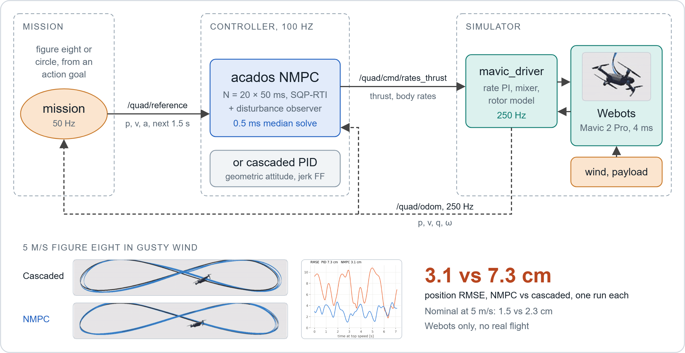
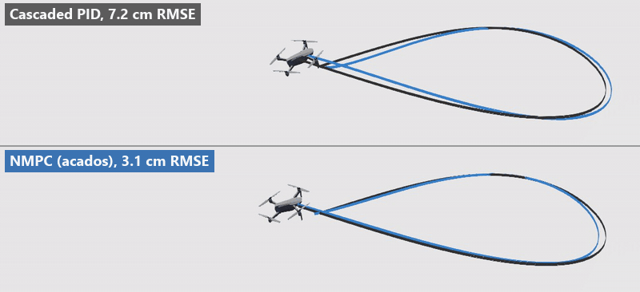
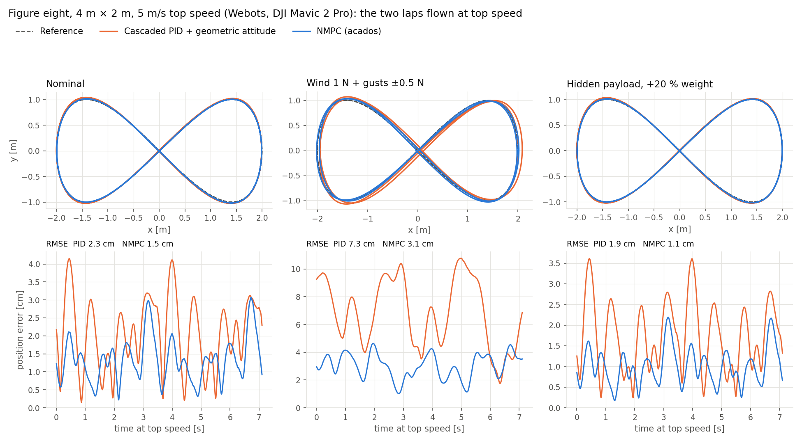

# quadrotor-ros2: nonlinear MPC vs. cascaded geometric control in ROS 2 and Webots

[Benchmark data](results/benchmark) · [Formulation and tuning](docs/FORMULATION.md) ·
[Checks and reproduction](docs/reproduce.md) · [Full ROS graph](docs/ros_graph.png)



A C++ ROS 2 Jazzy stack that flies a simulated DJI Mavic 2 Pro in Webots with two interchangeable controllers, an
acados NMPC solved in 0.5 ms and a cascaded geometric controller. On a 5 m/s figure eight in gusty wind the NMPC
halves the tracking error (3.1 vs 7.3 cm RMSE, one run per case). A personal project from October 2026, in
simulation only.

## Method

Both controllers read `/quad/odom` and the reference and publish collective thrust and body rates on
`/quad/cmd/rates_thrust`, the split PX4 uses, so they can be swapped without touching the simulator side. A Webots
driver plugin closes the body-rate loop and models the rotors. The NMPC has 10 states (position, velocity,
quaternion) and 4 inputs (thrust, body rates), with the external acceleration estimated by a disturbance observer
as a parameter; one SQP-RTI iteration per 10 ms step over a 1 s horizon. The baseline is P on position, PI on
velocity, geometric attitude control (Lee et al. 2010) with tilt capped at 60°, and body-rate feedforward from the
reference jerk (Mellinger and Kumar 2011). Equations, weights and gains: [docs/FORMULATION.md](docs/FORMULATION.md).

All code in `src/` and `scripts/` is mine, except the acados C code in `src/quad_control/nmpc/c_generated_code/`,
which [`generate_solver.py`](src/quad_control/nmpc/generate_solver.py) generates.

## Results

Figure eight, 4 m x 2 m, position error against the analytic reference over the laps at top speed, one run per cell.
Neither controller knows about the wind or the payload; both get the same mass, reference, thrust limit and body-rate
limits. Source: [`benchmark_pid.json`](results/benchmark/benchmark_pid.json),
[`benchmark_nmpc.json`](results/benchmark/benchmark_nmpc.json).

| Scenario | Top speed | Cascaded: RMSE / max [cm] | NMPC: RMSE / max [cm] | NMPC solve: median / p99 [ms] |
|---|---|---|---|---|
| Nominal | 2 m/s | 0.1 / 0.4 | 0.2 / 0.3 | 0.49 / 1.00 |
| Nominal | 5 m/s | 2.3 / 4.1 | 1.5 / 3.1 | 0.49 / 1.16 |
| Wind 1 N + gusts ±0.5 N | 2 m/s | 7.1 / 10.8 | **3.6 / 5.1** | 0.46 / 0.79 |
| Wind 1 N + gusts ±0.5 N | 5 m/s | 7.3 / 10.8 | **3.1 / 4.6** | 0.50 / 0.86 |
| Hidden payload, +20 % weight | 2 m/s | 1.4 / 2.4 | 0.2 / 0.3 | 0.49 / 0.81 |
| Hidden payload, +20 % weight | 5 m/s | 1.9 / 3.6 | 1.1 / 2.2 | 0.53 / 1.02 |

The 4 m/s runs are in the JSON files. In wind the observer feeds the wind estimate into the model, while the PI
integrator waits for an error to build up. Without disturbance the two are close; thrust never saturated. More
findings and the checks behind the numbers: [docs/reproduce.md](docs/reproduce.md).



*Same 5 m/s figure eight, same wind and camera. A separate rerun recorded for the video: its log is not in
`results/`, and the table uses the benchmark run.*



## Install and quick start

Tested on WSL2 Ubuntu 24.04 with ROS 2 Jazzy and `ros-jazzy-webots-ros2`, Webots R2025a on Windows, acados v0.5.5
and CasADi 3.7.2 (the version that generated the committed solver code). Without acados only the NMPC is skipped;
the solver's C code is committed, so the build does not need Python.

```bash
git clone --branch v0.5.5 --depth 1 --recurse-submodules --shallow-submodules https://github.com/acados/acados.git ~/acados
cd ~/acados && mkdir build && cd build
cmake -DACADOS_WITH_QPOASES=OFF -DACADOS_INSTALL_DIR=$HOME/acados .. && make install -j4

mkdir -p ~/quad_ws && cd ~/quad_ws
ln -s /path/to/quadrotor-ros2/src src     # or clone the repo into src/
source /opt/ros/jazzy/setup.bash
colcon build --symlink-install && colcon test && colcon test-result --verbose
ros2 launch quad_webots sim.launch.py controller:=nmpc    # or controller:=pid
```

The Windows firewall must let WSL reach Webots on TCP 1234. Takeoff, trajectory and disturbance commands:
[docs/reproduce.md](docs/reproduce.md#usage).

## Code structure

| Component | File | Role |
|---|---|---|
| NMPC | [`generate_solver.py`](src/quad_control/nmpc/generate_solver.py), [`nmpc_controller.cpp`](src/quad_control/src/nmpc_controller.cpp) | OCP in acados; ROS 2 node with the disturbance observer |
| Cascaded baseline | [`position_controller.cpp`](src/quad_control/src/position_controller.cpp) | P, PI, geometric attitude, jerk feedforward |
| Reference | [`reference.hpp`](src/quad_control/include/quad_control/reference.hpp) | reference interpolation and flatness attitude, shared by both |
| Driver plugin | [`mavic_driver.cpp`](src/quad_webots/src/mavic_driver.cpp), [`mixer.cpp`](src/quad_webots/src/mixer.cpp) | state, rate loop, mixer, rotor model, failsafe, disturbances |
| Messages | [`quad_interfaces`](src/quad_interfaces) | `RatesThrust`, `ReferenceTrajectory`, `FollowTrajectory`, `GoTo` |
| Mission | [`mission.py`](src/quad_mission/quad_mission/mission.py), [`trajectory.py`](src/quad_mission/quad_mission/trajectory.py) | takeoff, landing, analytic figure eight and circle |
| Benchmark | [`scripts/`](scripts) | runs, metrics, figures |

## Limitations

- One simulator, one drone, no sensor noise or state estimator: the controllers see the Webots state.
- One run per cell and deterministic disturbances, so the run-to-run spread is not measured.
- The NMPC model is close to the simulated drone: same mass, and no aerodynamic drag anywhere.
- The NMPC has no tilt constraint and reached 62° in the 5 m/s wind case; the cascaded controller is capped at 60°.
- The driver applies its own first-order rotor model (30 ms), since the Webots propeller model lagged by seconds in my
  tests. No PX4 SITL and no real flight.

## References and credits

- T. Lee, M. Leok and N. H. McClamroch, "Geometric tracking control of a quadrotor UAV on SE(3)", IEEE CDC, 2010.
- D. Mellinger and V. Kumar, "Minimum snap trajectory generation and control for quadrotors", IEEE ICRA, 2011.
- M. Kamel, M. Burri and R. Siegwart, "Linear vs nonlinear MPC for trajectory tracking applied to rotary wing micro aerial vehicles", IFAC World Congress, 2017.
- S. Sun, A. Romero, P. Foehn, E. Kaufmann and D. Scaramuzza, "A comparative study of nonlinear MPC and differential-flatness-based control for quadrotor agile flight", IEEE T-RO, 2022.
- [acados](https://github.com/acados/acados) (BSD-2), [CasADi](https://web.casadi.org) (LGPL), [Webots](https://cyberbotics.com) and [webots_ros2](https://github.com/cyberbotics/webots_ros2) (Apache-2.0), with Cyberbotics' Mavic 2 Pro model.

MIT license ([LICENSE](LICENSE)). Citation metadata: [CITATION.cff](CITATION.cff).
