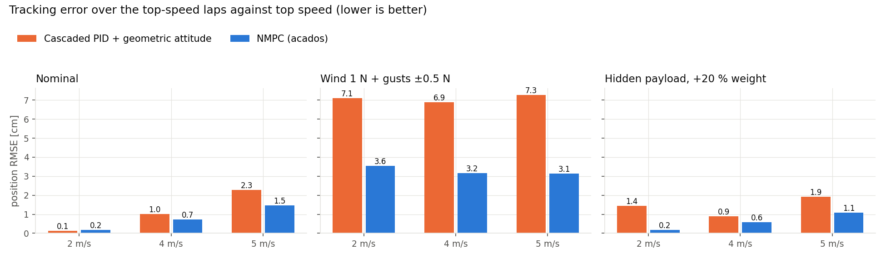

# Checks, usage and figures

Back to the [README](../README.md). Controller formulation and tuning: [FORMULATION.md](FORMULATION.md). Full ROS
graph, as recorded from the running stack: [ros_graph.png](ros_graph.png).

## How I checked it

- The baseline is tuned, not a strawman: jerk feedforward, and gains from a sweep at 4 m/s, the stiffest stable
  setting ([`position_controller.yaml`](../src/quad_control/config/position_controller.yaml)). Without the
  feedforward it was far worse at 4 m/s (an earlier run, not kept).
- The mass, 0.50 kg, comes from the hover thrust measured in two flights, 4.80 to 4.94 N
  ([`mavic.yaml`](../src/quad_webots/config/mavic.yaml)).
- Errors are computed against the closed-form path, not the logged reference samples, of which about 0.1 % were off
  by up to 3 cm ([`bench_metrics.py`](../scripts/bench_metrics.py)).
- Unit tests: gtest for the reference sampling and the mixer, pytest for the trajectories (`colcon test`).
- Three bugs changed the numbers. Odometry was stamped one simulation step late (4 ms is 2 cm at 5 m/s); it now uses
  Webots time. `laps=2`, sent as an int to a `float64` field, arrived as about 0, so the first runs flew no lap at
  top speed. SIGINT did not stop a background `ros2 launch`, so one run had both controllers driving the drone;
  `run_benchmark.sh` now uses SIGTERM.

## More on the results

All nine benchmark cells (the README table drops the 4 m/s rows):

| Scenario | Top speed | Cascaded: RMSE / max [cm] | NMPC: RMSE / max [cm] | NMPC solve: median / p99 / max [ms] |
|---|---|---|---|---|
| Nominal | 2 m/s | 0.1 / 0.4 | 0.2 / 0.3 | 0.49 / 1.00 / 2.43 |
| Nominal | 4 m/s | 1.0 / 1.9 | 0.7 / 1.6 | 0.48 / 0.78 / 2.20 |
| Nominal | 5 m/s | 2.3 / 4.1 | 1.5 / 3.1 | 0.49 / 1.16 / 1.43 |
| Wind 1 N + gusts ±0.5 N | 2 m/s | 7.1 / 10.8 | 3.6 / 5.1 | 0.46 / 0.79 / 1.62 |
| Wind 1 N + gusts ±0.5 N | 4 m/s | 6.9 / 10.5 | 3.2 / 4.9 | 0.48 / 0.89 / 5.99 |
| Wind 1 N + gusts ±0.5 N | 5 m/s | 7.3 / 10.8 | 3.1 / 4.6 | 0.50 / 0.86 / 1.46 |
| Hidden payload, +20 % weight | 2 m/s | 1.4 / 2.4 | 0.2 / 0.3 | 0.49 / 0.81 / 2.12 |
| Hidden payload, +20 % weight | 4 m/s | 0.9 / 1.6 | 0.6 / 1.0 | 0.49 / 0.90 / 1.68 |
| Hidden payload, +20 % weight | 5 m/s | 1.9 / 3.6 | 1.1 / 2.2 | 0.53 / 1.02 / 2.82 |

- In gusty wind the NMPC halves the error at every speed: the observer feeds the wind estimate into the model, while
  the PI integrator waits for an error to build up.
- Without disturbance both stay under 1.5 cm RMSE up to 4 m/s. The cascaded controller is slightly better at 2 m/s,
  the NMPC at 4 and 5 m/s, where tilt reaches 43 to 59°. Thrust never saturated in any run. This matches the
  nuanced conclusion of Sun et al. (T-RO 2022).
- With the hidden payload the observer removes the offset the cascaded controller shows at 2 m/s (0.2 vs 1.4 cm).
- Solve time 0.46 to 0.53 ms median on a 2016 laptop CPU (i7-6700HQ), against a 10 ms period.



## Usage

```bash
source ~/quad_ws/install/setup.bash
ros2 launch quad_webots sim.launch.py controller:=nmpc    # or controller:=pid; add rviz:=true for RViz
```

The log shows "Mavic driver ready" and, for the NMPC, "NMPC ready: N = 20, dt = 50 ms". Then, in another terminal:

```bash
ros2 service call /quad/takeoff std_srvs/srv/Trigger
ros2 action send_goal --feedback /quad/follow_trajectory quad_interfaces/action/FollowTrajectory "{shape: lemniscate, size: 2.0, max_speed: 4.0, laps: 2.0, start: {x: 0.0, y: 0.0, z: 1.5}}"
ros2 topic pub -r 20 /quad/disturbance/force geometry_msgs/msg/Vector3 "{x: 1.0}"    # 1 N of wind
ros2 service call /quad/land std_srvs/srv/Trigger
```

## Reproducing the results and figures

| Output | Command |
|---|---|
| `results/benchmark/benchmark_{pid,nmpc}.json`, raw logs in `results/benchmark/runs/` | `bash scripts/run_benchmark.sh [video path on the Windows host]` (about 35 min per controller) |
| `docs/benchmark_paths.png`, `docs/benchmark_rmse.png`, the table | `python3 scripts/plot_benchmark.py` (needs the raw logs) |
| README GIFs | `python3 scripts/make_gif.py <recording.mp4> docs/<name>.gif` |
| `docs/ros_graph.png` | `bash scripts/ros.sh python3 scripts/graph_dot.py > docs/ros_graph.dot`, then `dot -Tpng` |
| `docs/figures/overview.png` | hand-written `docs/figures/overview.svg`, crops of the GIF frames and `benchmark_paths.png` (`ov_*.png`) |
| solver C code | `python3 src/quad_control/nmpc/generate_solver.py` |
